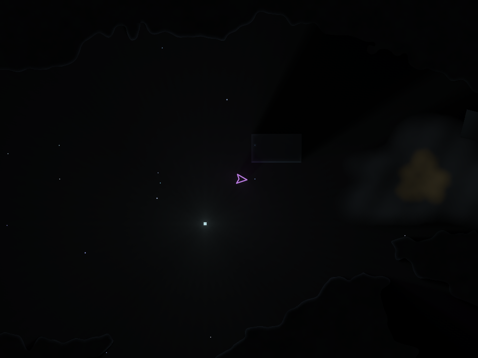

# Material engine validation

> Historical implementation record. Commands, MCP recipes, helper scripts and
> validation results below describe the recorded revision. The MCP product and
> its authoring helpers are retired. Current authoring uses saved `.chibi`/KDL
> files and [native checks](runtime-authoring.md); see [testing](testing.md) for
> current checks. These results do not verify the current checkout.

Validated in the shared checkout based on `1be98e1eb0ceaad6cc6dec6caa22a9994d341dc5`.
Existing renderer, editor, expression and Arena naming changes were preserved.
The [architecture and authoring guide](material-engine.md) describes the runtime
contracts. [Machine-readable scene evidence](reviews/material-engine-evidence.json)
records the snapshots and replays.

## Correctness

The focused native and Web suites cover pure field compilation, scalar parameters,
noise, primitives, composition, local and linked library functions, invalid values,
effects, recursion and cycles. Repeated bakes have identical hashes. Bulk samples
also match independent scalar evaluation. Invalid field or library edits preserve
the previous compiled field.

Material checks cover connectivity, partial chunks, collision rectangles, raycasts,
energy/resistance, fragmentation, release, source damage across chunk boundaries,
requests queued before the first bake, hot rebakes, controlled fragment inheritance,
and graph-authored blast health responses. Destruction works without a fluid world.

Scheduler checks cover component and resource dependencies, explicit ordering,
phases, barriers, unknown native callbacks, cycle/missing-dependency diagnostics,
query hot apply, and serial/parallel state and event-order parity. Graph registration
rejects sharing one mutable System object between two scheduled entries.

The editor regression suite also draws and refreshes field previews, exposes pure
library functions in field search, and excludes host-effect nodes. The graph
round-trip check preserves calls into libraries that contain generated expressions.

The fresh MCP protocol test creates and edits fields and Systems, rejects invalid
field edits atomically, compares preview PNG pixels and hashes, and inspects System
execution. All 60 Arena2D assets validate with the current native controller.

## Cave parity

| Grid | Native maximum distance error | Web maximum distance error | Occupancy differences |
| --- | ---: | ---: | ---: |
| 512 × 256 | 0.0000305175781 | 0 | 0 |
| 2048 × 768, shipping size | 0.000122070312 | 0 | 0 |

The native differences are floating-point rounding. Connectivity and occupied cells
match the test-only original cave generator. Existing material physics and damage
checks run against the migrated field-backed terrain.

## Authored scenes

Both scenes record and replay 120 fixed frames with identical world state and no
divergence. Native previews were rendered and visually inspected.

`MaterialStudy` uses the `FieldShapes.Islands` library through `MaterialIslands`.
At frame 60 it has zero fluid particles, six solids and two retained fragments.
Its standalone `FreeMotion` marker moves from x = −180 to approximately −168.
The lower specimen remains intact while the other receives authored material damage.

`Sandbox` retains the cave field, fluids and authored combat behaviors. Its marker
moves from x = −400 to approximately −388 after 60 frames using the same System.
The snapshot contains 98 solids and 993,976 occupied cells.

These are automated native snapshots, replays and render checks. A physical game
controller playtest was not part of this validation.

## Build and test results

| Check | Result |
| --- | --- |
| `CCACHE_DISABLE=1 make build` | Pass, native ASan/UBSan Debug build |
| `CCACHE_DISABLE=1 make test` | Pass, complete target |
| Focused material, field and scheduler suites | Pass, native and Web |
| Fresh MCP field/System protocol | Pass |
| Arena2D native asset validation | 60 of 60 pass |
| Arena gameplay acceptance script | Pass |
| Web `chibi`, `check-behavior-backend`, `check-material-engine` | Pass |
| Scene snapshots, 120-frame replays and native previews | Pass for both scenes |

The gameplay acceptance script checks camera following, movement/deadzone/exhaust,
boost speed, projectile consumption and expiry, inert enemy debris, shots through
carved debris, excavation, finite fuel burnout, free travel and deterministic replay.

Native tests use the macOS graphics and file-watching environment. Web checks run
compiled WASM under Node; they are separate from browser or controller playtesting.
The recorded protocol checks used fresh MCP server processes. That transport
is now retired; the current native authoring workflow is documented separately.

## Repeated performance measurements

Measured after builds and tests finished, on macOS arm64 with Homebrew Clang
23.1.1, Release `-O3`, sanitizers disabled and test assertions enabled. Each row
summarizes five consecutive runs; all samples are in the JSON evidence file.

| Workload | Median | Five-run range |
| --- | ---: | ---: |
| Cave field IR, 2048 × 768, 80 instructions | 78.769 ms | 78.210–80.113 ms |
| Field plus connectivity | 85.399 ms | 84.558–86.927 ms |
| Original specialized cave, including connectivity | 19.516 ms | 19.108–19.686 ms |
| Two independent Systems, 4096 entities × 120 frames, serial | 93.657 ms | 90.208–95.393 ms |
| Same Systems with automatic parallel scheduling | 88.280 ms | 83.959–89.937 ms |

The reusable field evaluator costs approximately **4.38×** the specialized
cave generator for this workload. The field is cached and baked on load or authored
changes; this cost is not paid each frame. The first generic implementation took
roughly 200 ms; retaining constants and X-only instructions reduced it to the
reported range. The direct generator remains only as a test oracle.

Every field run produced hash `b6a8fbf6b09264fb`, zero occupancy differences and
maximum distance error 0.000122070312. Parallel scheduling reduced median time by
**5.7%** for this specific pair of independent Systems. All ten serial/parallel
worlds produced hash `d75e090ab0e197ff`. This benchmark does not establish a general
game frame-rate improvement; systems with barriers or conflicting effects remain
serial.
