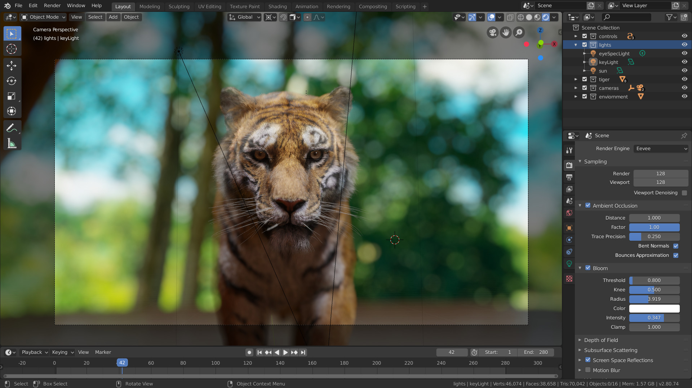
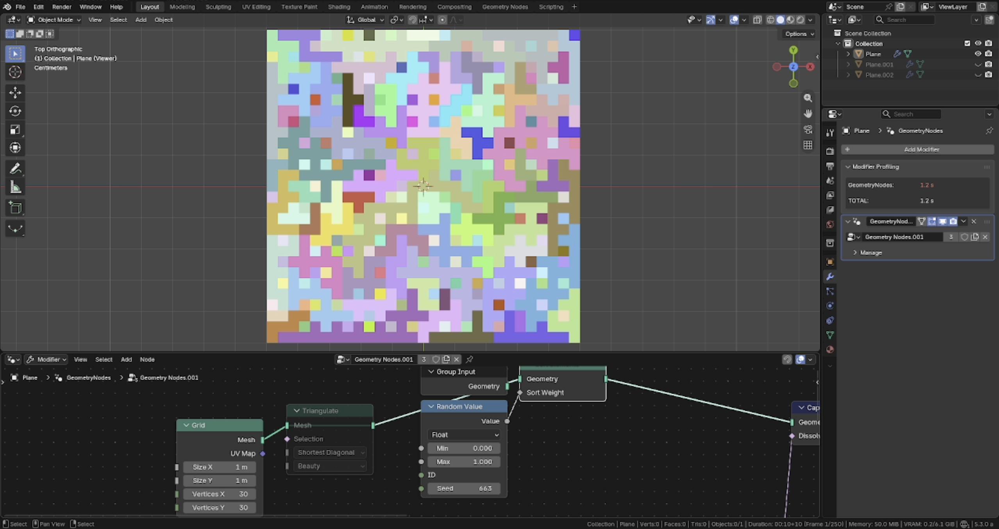

# Blender editor references

Screenshots supplied by the user as a reference, with LichtFeld Studio, for
Studio's visual polish and desktop interaction. Adapt these patterns to Chibi's
workflows and available features. Where a node control has a direct Blender
equivalent, check Blender's manual and its images before inventing a different
arrangement.

## What to carry into Chibi

- Compact, consistently aligned controls with a clear label/value relationship.
- A prominent viewport, with distinct boundaries between content, hierarchy,
  properties and node editing.
- Quiet neutral chrome and selective color for selection, active tools and node
  categories.
- Contextual toolbars close to the editor they affect.
- Grouped properties and collapsible secondary sections that reduce the number
  of simultaneous choices.
- Inline node controls and readable connection points, keeping the calculation
  and its editable values together.

Keep primary actions discoverable and secondary controls contextual. Evaluate
density against an actual authoring task; every visible icon or field should
help with the current selection or workflow.

## Supplied screenshots

The versions below come from the visible status bars. Add further screenshots
only from a current Blender release, with the version recorded. Original
publication and artwork credits were not included with the supplied files.

### Viewport and grouped properties — Blender 2.80.74

Useful details: the viewport dominates, the hierarchy and properties share a
stable right column, values align, and section headers organize dense controls.

### Viewport and Geometry Nodes — Blender 5.3.0

Useful details: the viewport remains visible above the node editor, local editor
headers identify each context, and nodes contain their own input controls.

