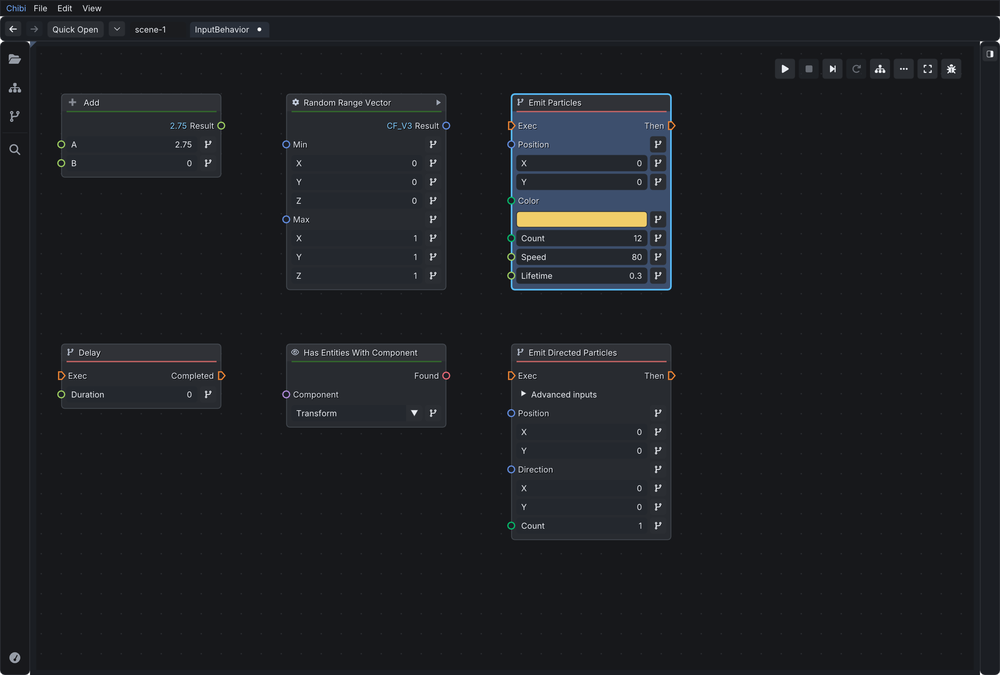
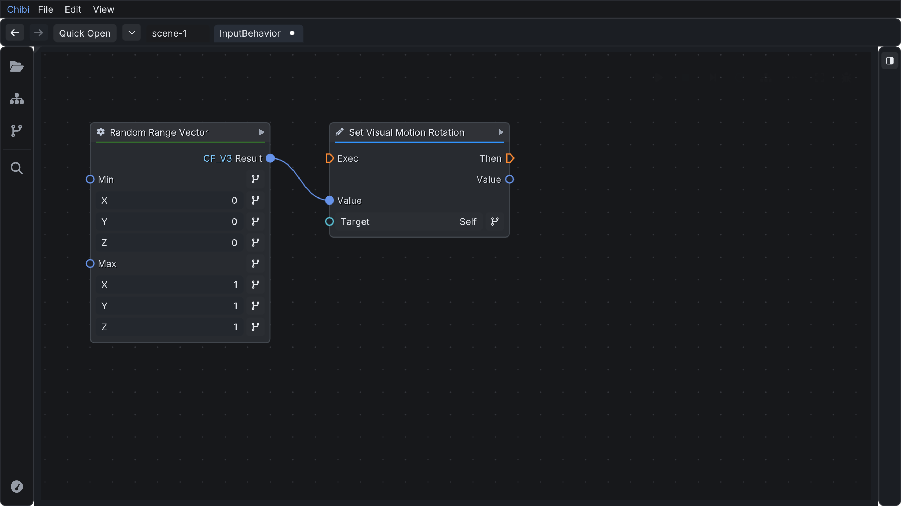
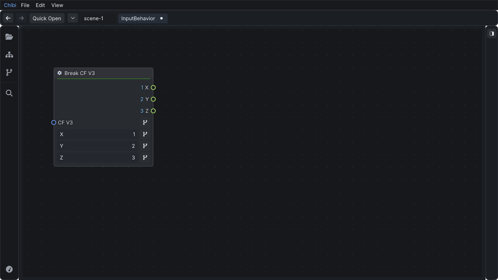
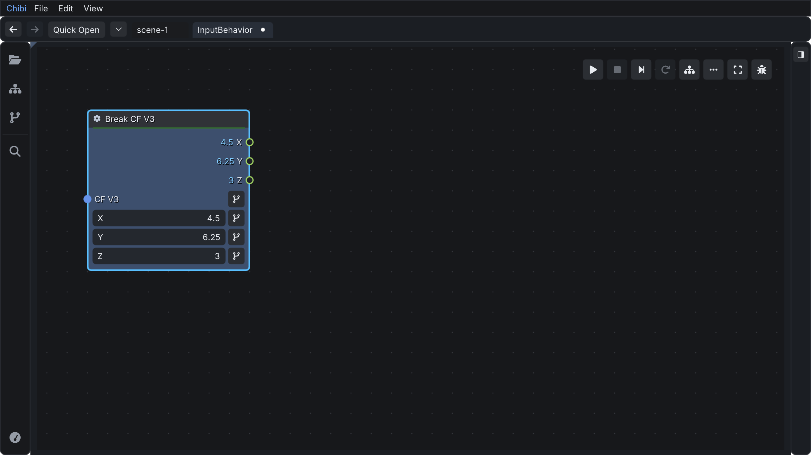
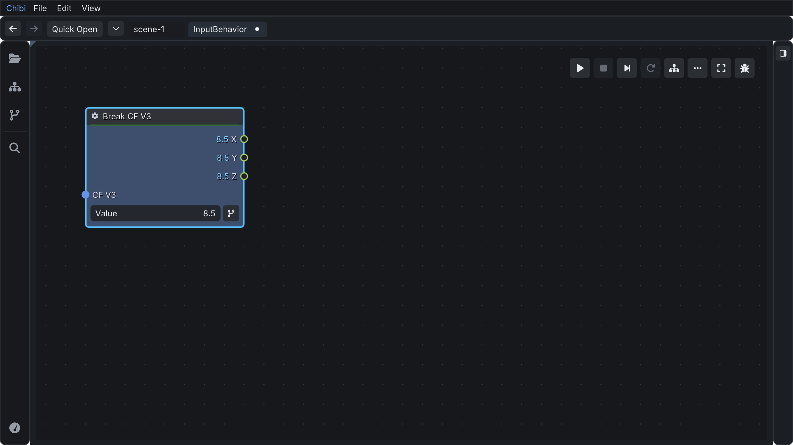
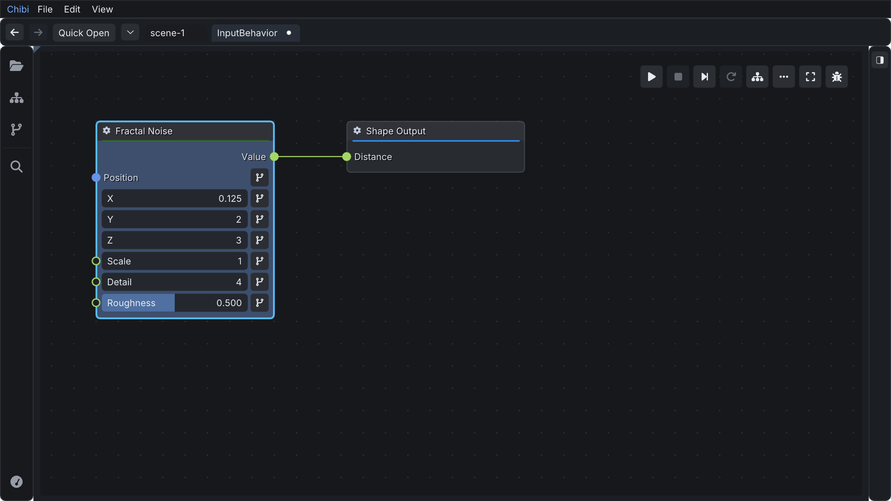
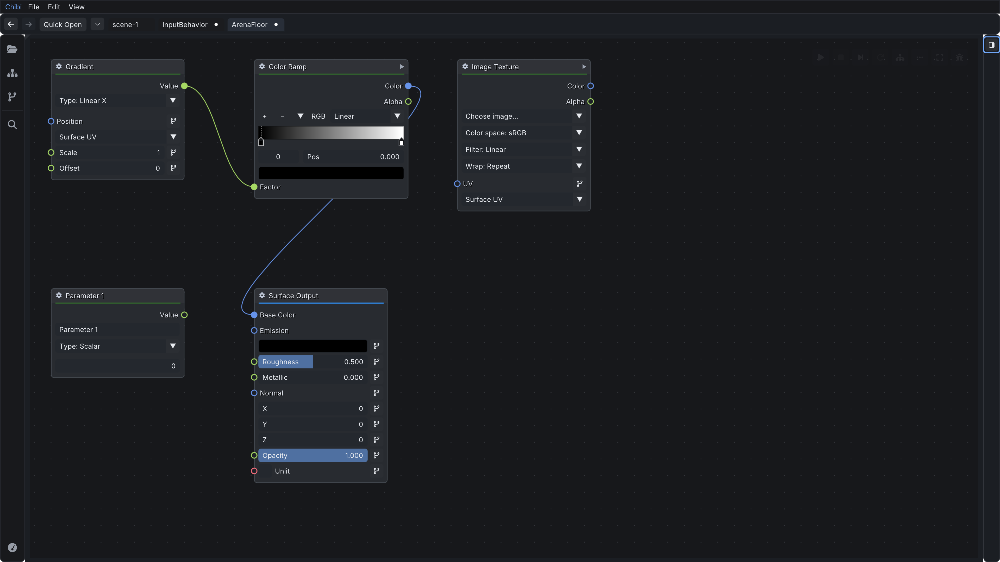
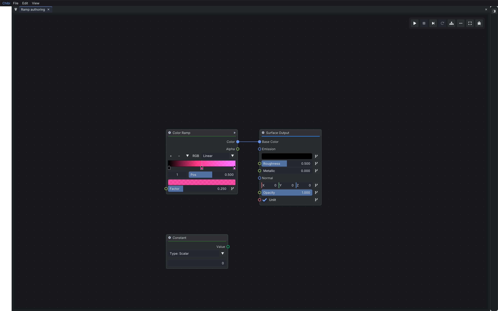
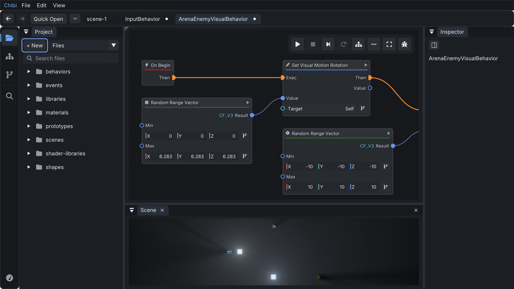

# Shared node controls, September 12, 2026

Behavior, function, material, shape, and shader-library graphs now share node
measurements, header styling, and value controls. Execution pins remain paired at
the top; data outputs appear above options and inputs. Math symbols sit in the
header of the common titled card.

Numeric controls fill the available width, with labels on the left and values on
the right. Vectors stack their labeled axes on separate full-width rows. Ranges retain
Min/Max endpoint labels. Dropdowns,
colors, text, and bound sources occupy a row beneath their pin label. Optional
advanced inputs open directly on the node. Bound and connected advanced inputs
remain visible when the disclosure is closed.

The Set Visual Motion Rotation source button now sits beside Target and Self.
Clicking the value field also opens the source picker. Runtime outputs no longer
reserve empty editing rows, and shared row padding is smaller. The measured gap
between this node's data output and input is 30 pixels at 100% zoom, down from 68;
the Target button's vertical offset is zero, down from 34.

Vector controls now follow the stacked layout in the supplied Blender reference.

| Before | After | Why |
| --- | --- | --- |
| Colored strokes beside small horizontal fields | Neutral full-width X/Y/Z/W rows | Matches the rest of the controls and leaves room for values |
| One source action for the vector | Source actions for the vector and each component | Allows literals and computed components to be mixed |
| Scalar sources could not feed a vector | One scalar broadcasts to all components | Makes a uniform vector easy to author |
| Inline scalar constants appeared as source chips | Scalar constants can be edited in place | Keeps value editing on the node |

Component sources use ordinary inline constructor nodes and connections. Replacing
or deleting the vector removes its owned component sources. Runtime and shader
regressions verify broadcast values and mixed components after save/load; native
interaction checks verify numeric entry, source selection, replacement, and Undo.

Validation passed: `make build`, `make test`, the full native editor suite, and
the shader UI suite. The integrated working checkout also passed its build, unit
suite, and focused native node-control checks.

Inspector and event/library overviews omit asset-description paragraphs. The
pause menu omits its controls tutorial. Source hints and drag previews are
shorter; performance explanations are available on hover.

Shader nodes use the same controls and spacing. Document properties and
function/event signatures remain in Inspector; ordinary value and shader-option
editing is available on the canvas.

Color Ramp follows the layout and interactions in Blender's
[official Color Ramp reference](https://docs.blender.org/manual/en/latest/interface/controls/templates/color_ramp.html):
a compact toolbar, colored stop handles, an active-stop marker, a zero-based stop
selector beside Position, and a full-width color swatch. Ctrl-click inserts a
sampled stop. Add inserts beside the selected stop. The tools menu provides Flip,
Evenly distribute, Distribute from left, and Reset. Current engine support is RGB
with Linear, Constant, and Ease interpolation.

New graph views open at a readable 85–100% zoom. Large graphs start near an entry
or shader output, below the floating toolbar. Explicit Fit still frames the
whole graph. Returning to a local function restores its previous camera.

A sole root graph pane hides its duplicate dock tab when the document bar already
identifies it. The corner affordance reveals the tab for undocking. Shared docks,
detached panes, and nested functions retain their context.

Validation in the integrated checkout:

- `make build` passed.
- `test_suite --ui-native` passed: shared layout, scalar/integer/vector edits,
  dropdowns and colors, advanced inputs, independent Undo/Redo, serialization,
  glyph/control separation at three zoom levels, source binding, and dock/camera
  interactions. The value-edit check caught and fixed premature Undo grouping
  when a vector group reported deactivation while a child remained active.
- `test_suite --shader-ui` passed: ramp insertion, stop selection, numeric position
  entry, tools, colors, Undo/Redo, save/reload, and rendered preview updates.
  The 60-frame ramp gesture caused zero shader recompiles and changed rendered
  pixels. Inspector stayed hidden for the authoring checks.
- `test_suite --scene-documents` and the three-frame headless app check passed.
- The complete unit suite passed, including the content catalog.
- Changed C lines pass clang-format; `git diff --check` passed.

`make test` passed generation, reflection, reload, development, MCP protocol,
MCP authoring, and optimizer checks. It stopped in `tools/mcp/design-smoke.mjs`
on the VisibilityLab preview assertion, "the ship and wall must retain visible
geometry." That check covers scene-rendered pixels. The unit suite and remaining
scene-document and application checks were run separately.

Node-on-wire insertion is still absent; double-clicking or Alt-clicking a wire
adds a reroute point. Enum pins retain their type names, but generic member
metadata and enum dropdowns are still absent. Several built-in properties have
named choices. Prototype references still use text fields rather than a general
prototype picker.
