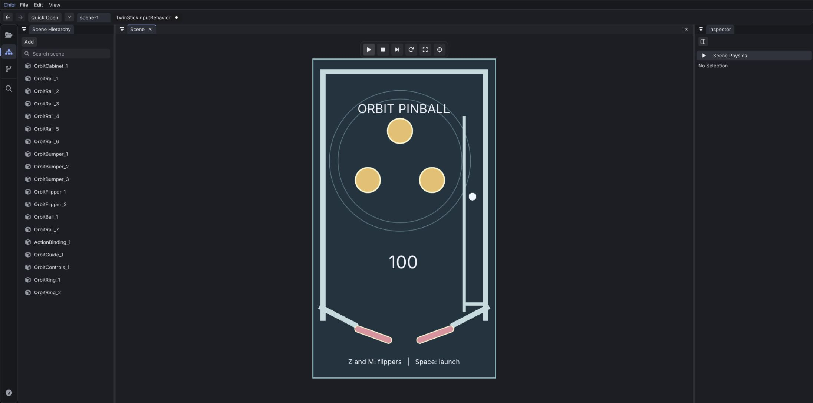
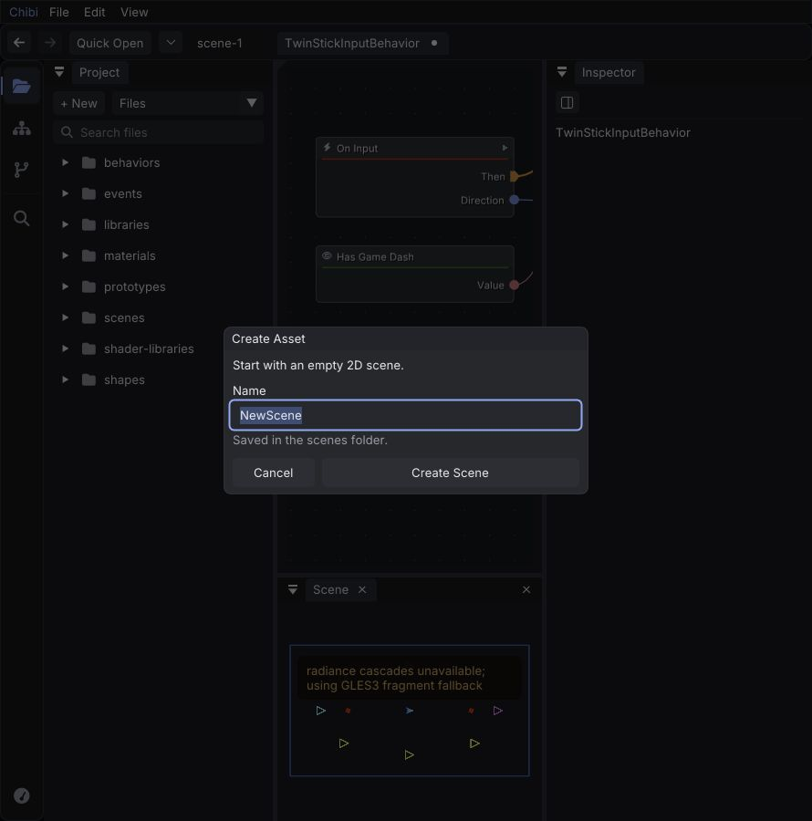

# Orbit Pinball: editor playtest and improvement plan

Orbit Pinball is the result of building and playing through the browser editor with computer use. It has a launch lane, a bouncing ball, two physical flippers, three bumpers, rally scoring, and immediate replay. The teal cabinet, gold bumpers, coral flippers, and orbital markings give it a different identity from the existing Arena content. The earlier Bloom Circuit experiment remains in the worktree, but it was too close to the existing game and did not fulfill the intended pinball direction.

Open [Orbit Pinball in the local editor](http://127.0.0.1:8108/chibi.html?scene=scenes%2FOrbitPinball.json). Press Play if stopped. Space launches or relaunches and resets the score; hold Z and M for the left and right flippers. Contacts award 100 rally points, including rail contacts. After a drain, press Space to try again. This is a playable prototype: it does not yet have a three-ball match, bumper-specific scoring, sound, or a game-over screen.



The work lives on `cwaldner/editor-play-lab` in `/private/tmp/cblueprints-editor-play-lab`, based on `a055888c`. The original checkout was left untouched. All game assets were authored through the editor UI: component editing, instance overrides, duplication, behavior connections, field bindings, arrangement, and saves. Source edits implement reusable engine/editor/tooling capabilities and their tests. MCP was exercised by tooling checks, not used to author the game.

Authored data and the OrbitLaunch and OrbitFlipperMotion graphs own the layout, camera, palette, gravity, launch velocity, pivot motion, key choices, scoring, and reset sequence. The follow-up removed the dedicated acceleration and rotary-drive components. Shared source supplies kinematic angular velocity, collider restitution/friction, draw layers, and label centering. A separate rotating-gate prototype checks angular motion without pinball controls or scoring.

What I like: prototypes and instance overrides make repeated rails and mirrored flippers practical; the behavior graph can express launch, score, and reset without a game-specific controller; Arrange helps recover a readable graph; and Play/Stop restores the authored scene. The separation between visual shapes and colliders is useful when tuning a table. The engine is flexible enough to make something materially different from its existing examples.

What I dislike: authoring still involves too much guessing about focus, hidden fields, and what an action actually did. A fast key tap could disappear. Bind could do nothing. A graph connection could alter another connection's type. A background could cover the ball after Stop. Those failures undermine trust more than a rough icon or missing animation does.

The design work uses apple-design, ui-ux-pro-max, and emil-design-eng: immediate feedback, readable controls, restrained motion, spatially consistent popups, visible focus, and layouts that respect available space. Repeated editing actions should respond immediately. The changes below came from actual authoring friction.

| Before | After | Why |
| --- | --- | --- |
| Key down and up within one frame could disappear, affecting Space and Delete. | Key edges are retained for one frame alongside held state. | A deliberate tap must produce an action; faster rendering should not be required. |
| Inspector Bind opened a popup in a different ID scope from its renderer. | The request is opened in the popup's owning scope. | A visible button must reliably open the chooser. |
| Connecting a resolved numeric wildcard to text could change the arithmetic node's type and break existing links. | The editor inserts the required conversion while retaining numeric arithmetic. | Adding a connection should preserve established data flow. |
| Expanding Get Widget exposed an unregistered nominal kind type. | Widget kind uses the same reflected integer contract as other component choices. | Every field offered by the editor must compile. Existing asset values remain valid. |
| The score formatter prevented whole-function graph execution. | Format Text supports the compiled host-call path, fixed arguments plus variadic values, and owned result strings. | An ordinary HUD operation should not force a slower execution path. |
| Scene draw order depended on ECS iteration order. | An authored appearance layer determines order, with stable entity ordering within a layer. | Backgrounds and decoration must stay behind gameplay after edits and restart. |
| A supported fragment-rendering fallback displayed a persistent notice over the game. | The normal fallback leaves the game unobstructed; diagnostics remain available in the runtime panel. | Routine renderer information should not dominate the play surface. |
| Label text was always left aligned inside its rectangle. | Authors can center label text independently of widget position. | Scores should remain centered as the number of digits changes. |
| Pinball required gravity, bounce, and a moving arm that transfers motion to the ball. | Graphs own gravity and pivot motion; ordinary bodies expose angular velocity, restitution, and friction. | Physics capabilities stay reusable while game rules remain editable content. |
| A timing test assumed even the shortest setup step consumed a measurable clock tick. | It permits zero-duration setup and compares accounted time in integer nanoseconds. | A fast machine should not cause an intermittent false failure. |

Earlier fixes from the same playtest remain useful: named scene/prototype/behavior creation dialogs; first-save paths; blank prototypes containing only a transform; numeric values that do not silently clamp to zero; editable prototype vectors/text and scene text; scene duplication with Undo/Redo; and a readable default inspector width. The browser save bridge writes authored JSON atomically to this worktree and restores it on refresh. Native reload retries stay incremental with Ninja, and MCP launch/smoke scripts respect the configured build directory.



The improvement plan is ordered by its effect on everyday authoring:

1. **Make editing state obvious.** Show the real scene name in its tab, expose keyboard/game focus, distinguish inherited values from overrides consistently, and make per-instance vectors editable. Add search to scene Add and component/field lists. Acceptance: create and duplicate a noncombat object and a HUD widget, edit their values, save/reopen, and undo/redo without guessing which document or input target is active.
2. **Make graph corrections direct.** Replace an existing execution link when deliberately reconnecting it, or give an immediate explanation when it cannot connect. Improve binding discovery for unresolved Generic inputs. Refresh validation messages when their cause disappears and let messages focus the offending pin. Acceptance: build the pinball scoring rule, change its output formatting, and repair an invalid connection without deleting unrelated links or retaining stale errors.
3. **Make scene composition faster.** Add discoverable layer controls, snapping, alignment, keyboard duplication, and consistent transform editing. Acceptance: mirror the two flippers and place the rings behind the bumpers entirely through visible authoring controls.
4. **Improve the play view and HUD layout.** Preview HUD widgets while editing; distinguish camera-relative and viewport-relative anchors; collapse secondary panes when the viewport is too narrow; make Play/Pause/Stop and reload/save state obvious. At 960×760, controls remain usable but both sidebars squeeze the table and the title moves toward its top rail because HUD and fitted camera space differ. Acceptance: this table, its title, score, controls, and creation dialogs remain legible at 960×760 and the normal desktop size without manually repairing offsets.
5. **Make the browser editor easier to operate and reload.** Expose semantic control names beyond the single canvas accessibility node. Add visible save progress/errors when the synchronous save contract can become asynchronous. Support a rebuild/reload workflow that restores the current document, pane layout, and authored state. Investigate the intermittent fractional-DPR sizing issue. Acceptance: keyboard and computer-use workflows can identify controls, and an application rebuild returns to the same useful editing context.

For the game itself, the next pass should add a finite three-ball round, drain feedback, a high score, separate bumper awards, and concise hit/launch sounds. Then tune the flipper catch zone and launch strength through actual play. A general contact-effect or sound capability should be driven by authored events if this exposes a concrete missing feature.

Validation includes the full native main suite, scene-document/checkpoint checks, native generation/reflection/reload/development/MCP checks, native and WebAssembly backend checks, three save-server tests, physics cases covering acceleration, restitution, a moving-arm strike, held/released input, and rotation across pi, plus focused SDL keyboard checks for quick taps and held controls. The timing case passed twelve consecutive simulation runs after its correction. The expanded widget getter and field mutation have a regression check. Format Text is checked with mixed inputs, an unused Generic spare, repeated dispatch, retained strings after activation release, and no oracle calls. The follow-up also supplies Tick Delta Seconds to event graphs and keeps float-to-double variable bindings compiled. Its audit reported all 40 authored event entries using whole-function execution.

Computer use verified Inspector Bind, quick Delete on a temporary node, launch into the field, growing score, resetting to zero, and relaunching. A browser run reached 3,100 rally points before a drain. Flipper physics is covered by the native press/hold/release and strike test; quick taps were also sent through the browser, but a sustained human play session is still useful for judging feel. Native visual interaction was unavailable through computer use, so visual authoring and play used the browser build. Native builds use RelWithDebInfo with sanitizers disabled; this is not sanitizer evidence.

The follow-up corrected initial button-release handling and isolated the firing-cadence fixture from an enemy that consumed live projectiles. Final combined-branch validation is recorded below. The intermittent fractional-DPR issue is not claimed fixed.

Native hot reload was verified with a real dialog-code edit: the editor loaded a second application generation with the same resident host fingerprint and no restart-required message. Browser asset saves survive refresh and server restart. Browser C/WASM code replacement is still a rebuild plus server restart and page reload; it is not hot module replacement.

To restart this worktree's browser preview:

```sh
cd /private/tmp/cblueprints-editor-play-lab
python3 tools/web_serve.py --build build-web --project . --port 8108
```

The server serves an immutable HTML/JS/WASM/data snapshot. After changing C code, rebuild the browser target and restart the server. For native development use `make dev DEV_BUILD_DIR=build-dev/ninja PROJECT=. SCENE=scenes/OrbitPinball.json`. Changes to resident host/framework code require a restart by design.

## Integration validation

The material-world integration preserves authored draw layers alongside SDF
damage surfaces, fluid rendering and reflections. The combined physics schema
includes both material-body drive and kinematic angular velocity.

The native UI regression fixtures now use the macOS editing modifier, the
current Count Members Snapshot graph, an explicit keyboard Fire binding and a
clear firing lane. The performance-panel fixture restores its wide window after
standalone play. These corrections remove assumptions about scene controls,
nearby targets and previous test layout.
