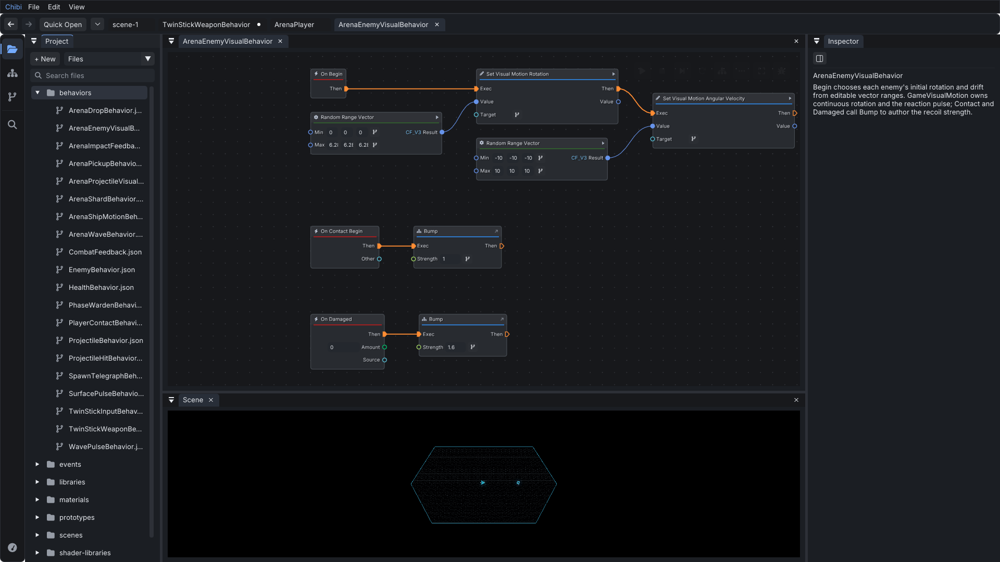
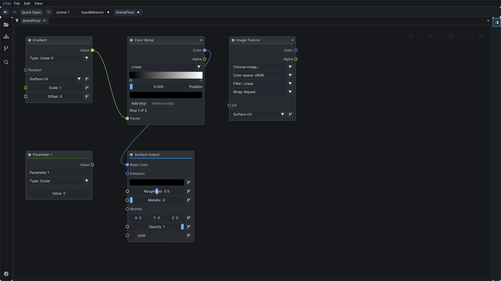
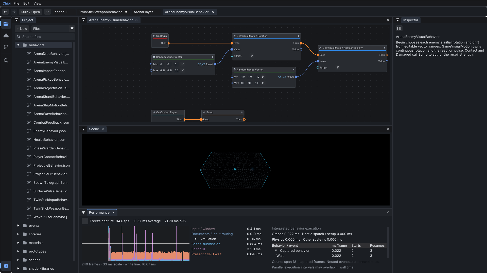
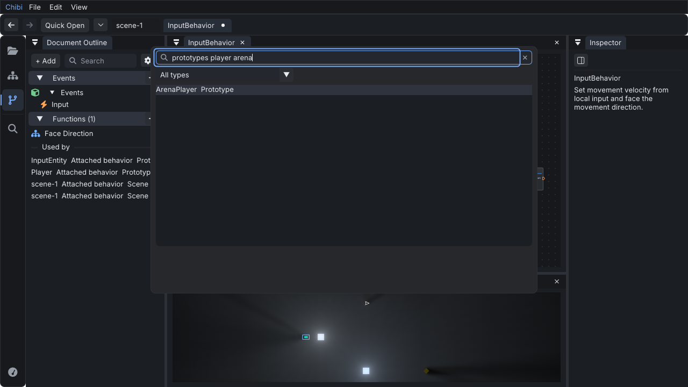

# Editor workspace review

September 11–12, 2026. Reviewed the supplied feedback and screenshots, current
code, and native renders at 1280×720 and 1920×1080. The supplied feedback is
advice to evaluate, not a specification. This review reflects the subsequent
requests for an activity rail, improved search, and Blender-inspired shader nodes.

## Implemented

| Change | Result |
| --- | --- |
| Activity rail | Project, Scene Hierarchy, and Document Outline have stable positions. Clicking the active destination collapses its sidebar; selecting another opens it. Quick Open and Performance have separate shortcuts. Tooltips identify each icon. |
| Removed Graph / Scene / Split | Docking and View control the workspace. The additional mode buttons are gone. |
| Full-height Project sidebar | Files and Asset catalog are alternate views that retain their query. Long names truncate with full-path tooltips; New remains visible. |
| Shared ranked search | Asset browsing, Quick Open, and node search recognize reordered words, prefixes, CamelCase initials, and small spelling errors. Names outrank paths and keywords. Compatible-pin filtering remains in node search. |
| Keyboard Quick Open | Arrow keys select results while typing focus stays in search. Changing the query selects the new best match. |
| Document tabs | Labels omit `.json`, mark unsaved edits, scroll on overflow, and have bounded widths and path tooltips. An open-document menu makes crowded workspaces navigable. Close preserves Save/Discard/Cancel. |
| On-demand Performance | Starts hidden in the default bottom dock. A wide pane uses columns for history, timing, and simulation details. The rail opens it directly. |
| Quieter styling | Softer borders, raised inputs, restrained selected tabs, and corrected chevron glyphs reduce visual noise. |
| Shader node layout | Material, Shape, and Shader Library outputs appear above settings and inputs. Shader controls use the node width. Execution graphs retain their existing layout. |
| Inline shader editing | Parameter names/types, constants, gradient modes, ramp interpolation/stops, image selection, filtering/wrapping, contextual defaults, colors, vector axes, and scalar values are editable on nodes. Normalized properties use sliders. |
| Value Undo | Finishing a value edit is recorded before its adjacent binding button is drawn, fixing slider edits that previously failed to get an independent Undo entry. |

Saved docking arrangements are respected. **View > Reset Layout** applies the
new default dock placement.

The shader screenshot is a native editing fixture containing ordinary Gradient,
Color Ramp, Image Texture, Parameter, and Surface Output nodes. It is a rendered
editor interaction test, not a mockup. Inspector remains useful for previews,
diagnostics, and document properties; shader node editing no longer depends on it.

## Search choice

The first improvement is a deterministic local matcher. `velocity compute`, `CV`,
and `compute velcoity` rank **Compute Velocity** first. Existing node keywords
provide aliases. This delivers useful tolerance without loading a model or
requiring a service. Semantic search remains a possible later addition if actual
queries expose vocabulary gaps that aliases and ranking cannot cover.

## Wire insertion and Unreal

Epic documents dragging from a pin to empty space to open a context-sensitive
menu and automatically connect the new node. Ctrl-drag can move an existing
connection. The reviewed documentation does not describe general insertion of an
existing node by dropping it over a wire. See Epic's
[Connecting Nodes](https://dev.epicgames.com/documentation/en-us/unreal-engine/connecting-nodes-in-unreal-engine)
and [Nodes](https://dev.epicgames.com/documentation/en-us/unreal-engine/nodes-in-unreal-engine).

The [Node Graph Assistant plugin](https://github.com/pdlogingithub/UE4-Node-Graph-Assistant)
explicitly provides insertion on wires and automatic connection while moving
nodes. That behavior is useful inspiration. For Chibi, I would require a visible
insertion preview, an unambiguous compatible input/output pair, and one Undo
operation. Ambiguous nodes should not reconnect silently. Wire insertion was
researched in this pass and has not been implemented.

## Feedback decisions and further priorities

- **Adopt:** clearer workspace hierarchy, direct navigation, better search, quieter
  tabs, diagnostics on demand, and complete inline shader controls.
- **Skip:** minimap, educational Inspector, decorative animation, and additional
  view modes. These do not address the current authoring bottlenecks.
- **Keep contextual:** viewport tools should expose capabilities the editor
  actually has. Runtime change application needs its own ownership and conflict
  design. A command palette is a useful separate follow-up.
- **Next: readable graph framing.** A graph that fits can still be too small to
  edit. Evaluate opening at a readable zoom and framing useful entry points.
- **Next: clearer document/play context.** Make the edited graph, inspected
  object, and simulation target easy to distinguish during real authoring.
- **Next: reduce repeated graph chrome.** The global document tab and dock tab
  repeat the asset name. Evaluate nested functions and detached panes before
  removing context those workflows use.

Blender's strongest contribution here is that a node contains the controls needed
to understand and edit it. Consistent control placement and reliable Undo matter
more than copying every visual detail. Apple's
[sidebar guidance](https://developer.apple.com/design/human-interface-guidelines/sidebars)
also supports a stable navigation hierarchy. The implementation retains ImGui's
existing docking and native interaction machinery.

## Validation

- `make build` and the complete `make test` workflow passed in the integrated
  checkout: generation, reflection, reload, development host, MCP, unit checks,
  scene document/checkpoint checks, and the headless application smoke run.
- `build/test_suite --ui-native` passed on the final build with ASan and strict
  UBSan error handling. It covers the activity rail, collapse/reopen, keyboard
  Quick Open, retained file/catalog queries, document navigation, existing input
  bindings, inline sources, and shader controls with Inspector hidden.
- `build/test_suite --shader-ui` passed on the final build with the same sanitizer
  settings. It covers vectors, color pickers, ramp interpolation/stops, texture
  settings, image drop/picker replacement, context defaults, Undo/Redo,
  serialization, and rendered Surface updates. Image and context editing are
  explicitly exercised with Inspector hidden.
- Native testing exposed and fixed a color-ramp checkerboard division by zero
  when graph zoom made a cell smaller than one pixel. The repeated run completed
  without sanitizer diagnostics. The value-edit Undo fix is covered by an actual
  slider interaction followed by Undo and serialization of a prior texture edit.
- Earlier focused native scenarios passed for document closing, Arrange/Undo,
  Performance Freeze/Resume and its activity shortcut, and spatial prototype
  placement. These were focused authoring checks, not a full arena gameplay run.
- Formatting and `git diff --check` passed for the changed code. Screenshots were
  inspected at both workspace sizes. This pass does not claim a complete usability
  study or a general frame-time benchmark.
