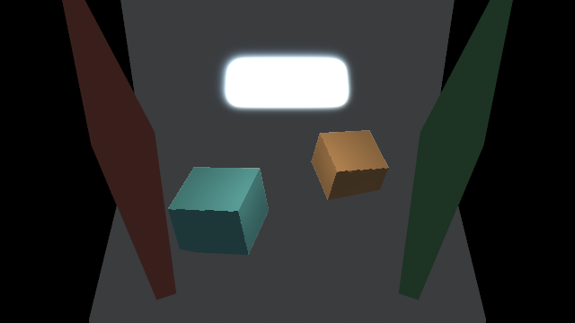
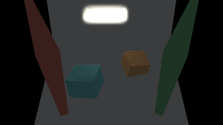

# SDF Lab

Authored distance graphs feed the shared surface-material renderer and planar
HRC. Every shape uses ObjectPosition in local world units, with conservative
GameGeometry3D bounds. These scenes require an engine with GameSdfSurface3D.

This is a direct analytic SDF experiment. It traces each visible object's
bounded shape graph, computes its surface normal, and writes the hit depth
into the same depth buffer as meshes. It does not extract triangles or cache
a sampled distance volume. Existing Material graphs shade the hit position.

| Scene | Content |
| --- | --- |
| SdfShapes | Sphere, rounded box, torus, box with a cylindrical cut, sphere/slab intersection, and a smooth union of two spheres. |
| SdfMotion | Rigid torus rotation/banking, a radius changing with simulation time, and a static sphere control. |
| SdfHrcComparison | Matching triangle and distance boxes with the same surface material and pose; a second overlapping pair checks their shared depth. |
| SdfInstances | 48 varied instances sharing one shape, one interleaved mesh, and four shape/material parameter controls: 57 entities. |
| SdfInstanceSwarm1000 | 1,000 rigidly animated cut blocks sharing one shape, with varied fallback colors, plus camera and three emitters: 1,004 entities. |
| SdfSwarm256 | 256 rigidly animated instances on a 16 by 16 grid, plus one camera and three emitters: 260 entities. |
| SdfSwarm1000 | 1,000 rigidly animated instances on a 40 by 25 grid, plus one camera and three emitters: 1,004 entities. |
| SdfStaticInstances1000 | 1,000 compatible static instances, with the same shape used by the moving crowd. Isolates repeated preparation. |
| SdfQualityStudy | Near/far and small/large surfaces, thin geometry, mesh overlap, and authored LOD controls including a changing-size threshold crossing. |
| SdfHorizonStudy | Continuous and separated surfaces, a moving blocker, varied light directions, and a gap within the six-unit shadow reach. |
| SdfZeroAmbientCamera | A 16-second perspective camera sweep past fixed SDFs, meshes, and three colored emitters, with no ambient fill. |
| SdfZeroAmbientOrtho | The same camera path and scene with orthographic projection, for a direct parallax comparison. |
| SdfAnalyticGradientOrbit | A complete circular camera path around the original eight-object gradient study, with a fixed target and distance and no backing plane. |
| Sdf25DCamera | Fixed-tilt 2.5D camera sway, bounded to ±0.3 radian yaw, with Gather lighting. |
| Sdf25DCameraBlur | The same constrained camera using reference Blur lighting. |
| Sdf25DOrtho | The constrained 2.5D sway using orthographic projection. |
| SdfOrbitCamera | A true 16-second orbit with fixed geometry and 3D emitters, zero ambient light, and geometry-aware surface Gather. |
| SdfOrbitCameraBlur | Identical orbit scene using the previous Blur surface lighting for comparison. |
| SdfOrbitOrtho | The same true orbit with orthographic projection. |
| SdfOrbitNoEmitters | The Gather orbit with all emitters removed; expected to remain black. |
| SdfOrbitDepthProof | Two emissive shapes isolate front/back changes from lighting. |
| HrcCornellCutaway | Cornell-inspired open-front diorama with moving area light, raised blocker and HRC bounce. |
| HrcCornellCutawayNoBounce | Matched control with HRC feedback and bounce disabled. |

SdfSwarm256 and SdfSwarm1000 share a 590 by 400 orthographic view, 13-unit grid spacing,
0.12 instance scale, shape/material distribution, and fixed half-resolution
HRC. Increasing the count also increases screen coverage; this pair measures
that combined workload. It does not isolate entity overhead at fixed coverage.
Instances reuse two shape assets rather than creating a combined scene graph.
Every instance has SdfRigidSweep: heading changes at 0.5 radians/second and pitch
follows 0.6 * sin(elapsed * 0.8). Position and scale remain fixed. Sphere rotation
is geometrically invisible; the rings expose the changing pose.

SdfBreathingSphere has radius 27 + 8 * sin(Time * 1.5). Its field changes each
frame while the renderer traces the authored graph. It does not remesh or
animate an extracted mesh. The smooth union uses a 12-unit polynomial blend.

The comparison boxes are both 60 by 44 by 60 units, with pitch 0.5 and roll
-0.15. The separate pair uses identical neutral material. The overlap pair has
center elevations -12 and +12 and distinct colors. The SDF box graph has no
rounding. HRC transport remains planar in all scenes.

To reconstruct the assets in a new copy of this project, after building its
controller:

```sh
node projects/sdf_lab/author.mjs
build/chibi_ctl --project-root projects/sdf_lab --format
```

The script uses the public MCP graph/prototype/scene authoring tools and the
project's explicit root. It creates graph layout automatically. Separate
`--graphs-only` and `--fixtures-only` phases allow graph authoring before a
controller with the new component is available. Existing graphs/prototypes
are retained; partially published swarm scenes can resume in bounded batches.

Launch the built worktree executable directly:

```sh
build/chibi --project-root projects/sdf_lab --scene scenes/SdfShapes.kdl
```

For previews, pass a JSON request to `build/chibi_ctl --project-root
projects/sdf_lab --render-request /absolute/path/request.json`. Set contract 1,
operation preview_scene, kind scene, name, width and height. Freeze simulation
for matched stills; let it advance for motion. Frame capture and pass timing
instrument the renderer and must be reported separately from normal warmed
frame measurements. Root-level tooling records validation and preview evidence.

Capture all seven scenes, or measure advancing frames in a release build:

```sh
python3 tools/check_sdf_lab.py
python3 tools/check_sdf_lab.py --build build-release --benchmark \
  --scene SdfSwarm256 --scene SdfSwarm1000
```

The benchmark excludes 240 warmup frames and the first 16 measured frames.
It includes simulation, rendering, a wait for scene GPU work, and the CPU
submission of the final UI/blit. It does not wait for that final presentation
work to finish on the GPU. The 60 Hz pacing wait is excluded. Use a quiet machine and separate output directories for repeated
runs. The preview helper defaults to `build/sdf-lab-evidence`.

## Instance batching experiment

Consecutive SDF objects with the same shape and material graphs share one proxy
mesh and one draw, up to 256 objects. Resolved parameter values can differ;
each instance selects its deduplicated parameter-table row. Positions,
rotations, uniform scales, conservative bounds, and fallback material colors,
emission and absorption can vary inside the batch. The record is 192 bytes per
instance and uses full-precision floats. This shares geometry and draw setup;
it does not quantize assets or reduce the number of distance evaluations per
visible pixel.

All SDF records in an ordered surface group upload together before drawing.
Each draw selects its slice of the shared buffer. The Cute dependency patch
exposes its existing instance-buffer functions through the public C API;
uploading separately for each draw would interrupt the Metal render pass.

A different shape or material graph starts another batch. Ordinary meshes and
authored render layers also separate groups. Actor order is preserved,
including the first actor winning equal-depth ties. The existing swarm scenes
alternate material graphs on every instance and deliberately remain an
incompatible-order control. SdfInstanceSwarm1000 uses compatible instances to
measure the other case at the same entity count.

The existing 2D particle path already feeds grouped, tiled material rendering.
These changes apply to 3D SDF surfaces. A future particle effect authored as
SDF instances could use this path, but particle simulation is unchanged.

Compare grouping with one instance per draw in the same release executable:

```sh
python3 tools/check_sdf_lab.py --build build-release --benchmark \
  --scene SdfInstanceSwarm1000 --sdf-batch-limit 1 \
  --output build/sdf-batching-evidence/reference
python3 tools/check_sdf_lab.py --build build-release --benchmark \
  --scene SdfInstanceSwarm1000 --sdf-batch-limit 256 \
  --output build/sdf-batching-evidence/batched
```

`performance.mesh_work` reports the last rendered frame's surface submissions,
SDF instance count, uploads and bytes. Each group containing SDFs uploads once,
regardless of the number of batches. It is not the total number of draws in
an HRC frame. A limit of zero selects the default of 256; one provides the
ungrouped reference path. Both use the same instance shader, so this comparison
isolates grouping rather than measuring the entire change from the earlier
uniform-based renderer.

## Rendering limits

- Enable GameSdfSurface3D, bind a scalar Shape graph in GameShader.shape, and
  set positive GameGeometry3D width, height and depth to contain the entire
  shape through its animation. Shape graph bounds remain the existing 2D
  authoring metadata; the 3D renderer uses GameGeometry3D for tracing bounds.
- Shape graphs must provide a conservative distance bound in object units.
  The current renderer uses at most 128 march steps and six distance samples for
  its normal by default, with an optional four-sample normal. Adaptive tracing
  can add bounded refinement evaluations. Arbitrary scalar fields can overshoot surfaces or fail to
  converge. Some silhouette stippling and thin-feature misses remain.
- Scene selection uses the projected bounding box, including empty regions
  such as a torus hole. Mesh and SDF objects share depth within their render
  layer. The current surface contract is opaque with zero-opacity cutouts.
- HRC still transports light in its 2D projection. These scenes do not add
  volumetric GI or resolve lighting through stacked 3D surfaces. The broad
  shadow wedges in the swarm are part of that existing approximation.
  Local relief shadows sample one visible height per pixel, generated from
  the SDF ray hit or mesh surface. The reference compositor uses up to ten nearby height
  samples for each of four incoming-light quadrants, with a direction inferred
  separately for each quadrant; broader HRC occlusion uses
  projected absorption. Optional directional horizons replace these local
  walks, as described below. The transport domain is a finite, camera-centered
  flat region, not a spherical volume. GGX/Smith/Schlick surface shading
  does not change that transport geometry.

Rigid motion only changes an object's transform. A future distance cache could
reuse one object-space field for many instances. Independent deformation may
require updating many cache regions; this implementation has no such update
cost, but reevaluates the analytic graph during every ray march. The swarm
scenes therefore establish a direct-rendering baseline, not a benchmark of
the sparse distance-cache approach discussed earlier.

## Surface optimization experiments

The optional `GameSurfaceQuality` component applies scene-wide surface settings.
Place one on a camera or scene settings entity. Defaults preserve supersampling,
central normals and the original trace tolerance:

- `resolution`: `Supersampled` renders at twice each axis; `Full` renders at 1x.
  Both mesh and SDF surfaces in the shared pass use this setting. The material
  resolve uses the corresponding four or one samples.
- `sdf_pixel_error`: zero keeps the original march. Positive values, up to one,
  allow a screen-size-dependent candidate threshold followed by bounded root
  refinement. Hits must still satisfy the original residual tolerance. Near
  tangent rays retain the original march. This is an experimental acceleration,
  not a lower maximum step count.
- `sdf_normal_mode`: `Central` takes six field samples; `Tetrahedral` takes four.
- `disable_sdf_lod`: forces full-detail graphs for comparisons.

An SDF object can specify `GameSdfSurface3D.low_detail_shape` and a positive
`low_detail_pixels` cutoff. It selects that graph when the largest dimension of
its projected bounds is at or below the cutoff. The cutoff uses logical material
pixels, independently of supersampling. Both graphs must fit the same authored
Geometry3D bounds. Existing parameter bindings and the material are retained.
Switching graphs is discrete; authors must choose a cutoff that hides the lost
detail. Omit the graph to retain full detail at every distance.

The preparation path retains visible surfaces from collection through rendering,
reuses staging storage, shares SDF proxy triangles and prepares each distinct
shape/material program pair once per ordered group. Counters report consumed
prepared surfaces, fallback builds and program preparations.

`GameHRC2D.surface_shadow_mode` selects `Reference`, `Horizon4` or `Horizon8`.
Horizon modes pack visible geometry relief and build directional visibility over
six world units before composition. Empty coverage stops each local search.
The default path rebuilds the maps every frame. Optional caching reuses clean
geometry tiles and repairs changes; camera reuse requires the restrictions
described below. Moving geometry is checked against the prior packed relief.
They use angular softness and interpolation, which can differ visually from
the reference height-penetration shadows. They do not add hidden surface layers
or 3D light transport.

Publish the additional fixtures through the public authoring protocol:

```sh
node projects/sdf_lab/author-optimizations.mjs
node projects/sdf_lab/author-optimizations.mjs --quality-fields
```

Preview requests accept a `surface_quality` object with `samples` 1 or 2,
`pixel_error` from zero to one, `normal_samples` 0, 4 or 6 and boolean `lod`.
Zero selects Analytic mode; unsupported graphs use four-sample normals.
An omitted object uses authored settings; omitted fields in an override object
use reference defaults. `horizon_directions` accepts 0, 4 or 8, where zero selects
the reference. `sdf_trace_debug` displays SDF trace costs with lighting and
tone mapping bypassed. Red encodes trace evaluations divided
by 128, green marks hits, and blue encodes normal graph calls divided by eight.
A differentiated graph counts as one call, including its derivative arithmetic;
a failed gradient followed by four samples counts as five. The displayed PNG
clamps values above one; raw RGBA16F fixture readbacks provide exact counts.
These counts exclude discarded rays and occluded fragments and do not measure
GPU time or individual arithmetic instructions.

The serial comparison driver is `tools/check_sdf_optimizations.py`. It separates
record/replay, image and measurement phases. CPU comparisons use preserved
executables, an identical isolated asset set and the same archived shaders on
both sides. Quality comparisons use one executable and change one option at a
time. Final evidence is in
[the optimization report](../../build/sdf-optimization-evidence/validation.md).

### Optimization validation

Native/Release builds, the full test target, focused rendering tests, deterministic
360-step replay, and serial/threaded Web builds passed. Actual browser inspection
caught and verified a fix for GLSL output indexing in the horizon shader. The
final shader-only fix passed native radiance and both browser paths. All original
34 lab assets remain unchanged. New graph layouts and native captures were
visually inspected; the moving LOD control was checked on both sides of its cutoff.

CPU reuse preserves exact images for both 1,000-instance crowds. The 1x mode
reduces surface-pass pixels by 75% and was faster in all three measured pairs,
with small-shape and edge differences. Four-sample normals use one third fewer
normal evaluations. Adaptive tracing helps the analytic sphere but slightly
increases thin-ring tracing work. LOD can split batches and add draws. Both
horizon modes pass motion/gap/reset checks and retain about 12.23 MiB of extra
canvas memory in their study scene.

All 48 paired measurements completed, but heavy unrelated host activity makes
most timing effects inconclusive. Quality modes remain optional. Existing
silhouette stippling and planar HRC transport remain limitations. The report
contains every timing range, validation boundary, capture and reproduction path.

## Batching validation

Native builds, focused SDF buffer tests, the HRC/radiance suite and the complete
`make test UPDATE_GAME_RUNTIME=0` rerun passed. Serial and threaded Web builds
passed. The final serial scene and threaded 1,000-instance scene were visually
inspected in Safari, including Play and changing transforms in the latter.

At frame 120, grouped and ungrouped PNGs were byte-identical in both new scenes.
SdfInstances reduced 52 SDF draws to six, plus its one mesh draw.
SdfInstanceSwarm1000 reduced 1,000 SDF draws to four. The latter still uploads
192,000 bytes of instance records per frame, in one upload. Two 360-step scenario
runs per new scene matched their world hashes without behavior failures. Prior KDL assets
were preserved by hash.

The focused GPU fixtures compare all five surface targets across chunk limits,
mesh interleaving, entity graph parameters, zero scale, equal-depth ties and
render layers. They also check buffer reuse after a mesh-only frame and a
reordered sparse frame. Independent analytic geometry and material checks pass.
Full conditions and paired measurement results are recorded in
[the batching validation report](../../build/sdf-batching-evidence/validation.md).

All 18 paired Release measurements completed with matching output and world
hashes. Timing varied substantially with concurrent host activity, including in
the control whose draw count was unchanged. These runs establish draw reduction
and correctness, but do not establish a frame-time improvement. The comparison
uses the new instance shader in both modes; it is not a matched comparison with
the earlier uniform-based renderer.

## Initial SDF validation on the development Mac

Before the batching experiment, native debug/release builds, the full
`make test` target, focused SDF/mesh GPU
tests, the HRC radiance checks, and serial/threaded Web builds passed. The
threaded browser build was visually inspected in Chrome. All five scenes ran
360 simulation frames without behavior failures; the 1,000-instance scene
also passed deterministic record/replay. Graph layouts, native stills and
spaced frames from the motion capture were visually inspected.

At 960 by 540 with half-resolution HRC on the M4 Pro, three release trials
gave median frame times of 4.42–4.99 ms for 256 instances and 8.96–9.97 ms for
1,000. The Chrome lab remained open during these runs, so these are timing
observations rather than an isolated capacity benchmark. They include
simulation, rendering and a scene GPU wait. Linux was not tested. The RTX
4080 Super is available for asset generation; it is not a specified runtime
target. Full conditions and local captures are in
[the validation report](../../build/sdf-lab-evidence/validation.md).


## HRC reuse studies

Five independent scenes exercise optional horizon reuse without gameplay:

- `HrcReuseChangingLights`: fixed receiver/blocker geometry with changing light intensity and fixed source geometry.
- `HrcReuseMovingBlocker`: a raised blocker translates across a continuous receiver.
- `HrcReuseCameraPan`: continuous camera translation exposes initially offscreen geometry.
- `HrcReuseIntegerPan`: camera translation is quantized to eight material pixels at 960×540, or four at 480×270; hierarchy reuse requires an aligned eight-pixel offset.
- `HrcReuseThinGaps`: a thin ring, narrow bore, and separate hills with 4- and 10-unit gaps exercise conservative hierarchy fallback.

`author-hrc-reuse.mjs` publishes through the public MCP protocol, verifies the
project root, validates/canonicalizes new assets, and preserves every prior KDL
file by hash. `tools/check_hrc_reuse.py` validates 360-frame record/replay and
checks that only the intended entity changes. It compares the four independent
`horizon_reuse` request booleans (`fuse_relief`, `cache`, `reproject`, `hierarchy`)
and combined modes. Cache and reprojection comparisons require exact PNG parity;
fusion/hierarchy differences are saved for rendered review. Pass counters do not
measure GPU cache hits or repaired pixels. The default 480×270 image captures
keep the validation workload bounded. Timings are a separate opt-in phase.

```sh
node projects/sdf_lab/author-hrc-reuse.mjs
python3 tools/check_hrc_reuse.py --build build --phase replay
python3 tools/check_hrc_reuse.py --build build-release --phase images
```

The five reuse scenes pass deterministic 360-frame replay and pose checks.
Native fixed-pose pairs preserve exact pixels for caching and batching controls;
hierarchy and normal differences are saved for direct review. The advancing-camera reprojection pair is exact and reports one reprojection
pass. The repaired near-plane control renders its cyan side face and submits
two visible SDFs. Final hierarchy/gap and combined-blocker pairs are exact;
all saved scene and graph images were directly inspected. Engine suites and browser validation are reported separately.
Both serial and worker Web builds also rendered disposable copies of the combined
horizon and varied-parameter scenes in Chrome. These four editor previews were
directly inspected without shader, WebGL or runtime failures. This is browser
rendering coverage, not a timing result or a full gameplay test.


### Analytic shape comparisons

`normal_samples: 0` selects Analytic normals. A recognized centered sphere graph
(`length(ObjectPosition) - radius`, with position-independent radius) uses exact
ray intersection and analytic normals; radius may come from time or parameters.
Supported arithmetic, vector and CSG graphs use a generated object-space
gradient. Unsupported operations and singular gradients use four-sample
normals. A gradient that fails at runtime costs one attempted gradient plus
the four fallback samples. `normal_samples: 6`
retains the central-difference reference. The driver prepares both choices at
the same 1× surface resolution for `SdfQualityStudy` and `SdfShapes`.

`SdfNearPlaneBounds` retains an ordinary sphere and a wholly offscreen
near-plane sphere, plus a small offset box crossing the near plane. The box
exposes a visible side face; the centered sphere originally used here had its
front surface clipped. Its capture checks that only two SDF surfaces submit.
Captures are at most 480 pixels wide and are directly inspected. The authored
near-plane control and engine/browser validation remain separate checks.


### Parameter batching and retained surface storage

Consecutive SDF actors with the same shape/material graphs can share a batch
when their resolved parameter values differ. Actor order and depth stay intact;
the batch cap remains 256 and `sdf_batch_limit: 1` is the reference. Instance
records remain 192 bytes. A separately uploaded table deduplicates parameter
content: each row holds 32 shape and 32 material vec4s (1,024 bytes), so actors
sharing defaults can share one row while unique values can require one row per
actor. The table uploads once per nonempty SDF group. Separate parameter
row/upload/probe counters avoid counting this table as instance upload bytes.
The `instance-batch-control` capture compares both batch limits in `SdfInstances`
and preserves exact pixels while reducing 52 SDF draws to three (53 total
draws to four), with five distinct parameter rows retained.

`surface_pixels` describes the active viewport/scissor crop;
`surface_capacity_pixels` describes retained grow-only allocation. Cropping
active rendering does not imply that attachment clearing avoids capacity costs.
The native `SdfInstances` batch-limit comparison preserves exact final pixels.
Full surface-target, parameter, ordering and storage GPU checks are recorded
separately from this authored-scene guide.


### Horizon reuse controls

`GameHRC2D` exposes four independent opt-in booleans, also available in the
preview request's `horizon_reuse` object. Authored fields retain the
`horizon_` prefix; only preview-object keys omit it:

- `horizon_fuse_relief`: packs relief alongside the full-resolution near-field pass; a separate pack remains when that pass is unavailable.
- `horizon_cache`: compares height, coverage and tilt in 16-pixel tiles, expands dirty tiles by shadow reach, and reuses clean directional samples. Light intensity changes do not invalidate static geometry.
- `horizon_reproject`: allows integer material-pixel camera translations with unchanged scale/projection, checking geometry and repairing exposed borders. Fractional shifts rebuild.
- `horizon_hierarchy`: builds half/quarter/eighth-resolution maximum-height and coverage bounds. It skips a chunk only when the bound cannot raise the current occlusion slope; otherwise it evaluates the reference fine samples. Mixed coverage and gaps retain fine-sample fallback. Cached hierarchy translations must align to eight material pixels.

Caching still submits comparison and reuse passes; CPU pass counters do not
prove the number of GPU cache hits. Final hierarchy and combined-mode captures preserve exact reference pixels
in the canopy/blocker and thin-gap scenes. Fragmented coverage can reduce the
opportunities to skip work. All four controls default off.


### General analytic-gradient study

`SdfAnalyticGradientStudy` compares differently rotated and scaled rounded boxes,
a torus opening, a hard CSG bore, smooth union, time-varying sphere radius,
parameterized CSG and a small noise displacement. `SdfAnalyticGradientFallback`
isolates the unsupported spatial-noise expression. Both scenes are selectable
explicitly and do not change the project start scene. Recreate the added assets
with `node projects/sdf_lab/author-gradients.mjs`; the author preserves existing
KDL assets and verifies the public MCP project root.

The comparison driver fixes the same simulation pose and uses one surface sample
with pixel-error adaptation and LOD disabled. The study compares six-sample
central normals to Analytic; the isolated fallback compares four-sample
tetrahedral normals to Analytic and requires exact image parity. Run bounded
captures at two fixed poses to exercise the breathing sphere:

```sh
python3 tools/check_hrc_reuse.py --build build --phase images \
  --case normal-analytic-gradients --case normal-analytic-fallback \
  --image-frame 0 --image-frame 90 --output build/sdf-gradient-evidence/images
```

These image comparisons measure visible differences. They do not establish frame
time or the number of surviving fragment evaluations. The engine gradient tests
and work-count checks are reported separately.

The native 480×270 captures at frames 0 and 90 passed with matching final
simulation states. The study differs from central normals at three and four pixels
by more than two RGB levels respectively (mean absolute RGB difference below
0.00081/255). Some isolated pixels differ substantially, so this is visual
approximation coverage rather than exact parity. The noise-only fallback is
byte-identical to four-sample tetrahedral normals at both poses. Reference and
Analytic images and the noise graph were directly inspected. The animated
sphere visibly changes radius between poses; the hard CSG bore is visibly open.
The final compiler and corrected bore pose were recaptured in
`build/sdf-gradient-evidence/images-final`. No timing benchmark ran.


### Hidden surfaces and sparse scratch regions

`SdfHiddenSurfaceStudy` places complex SDFs behind a nearer opaque mesh, a solid
SDF, a bored SDF with a visible opening, and a partial mesh cover. A moving mesh
blocker changes which parts of the last receiver remain visible. Covers and
receivers share orthographic projection so occlusion remains easy to review.

`SdfSparseScratchStudy` has four widely separated groups; each group contains
intersecting mesh and SDF surfaces at different elevations. It exercises empty
space between groups while retaining depth and submission-order interactions
inside each group. `SdfOcclusionNearPlane` crosses the perspective near plane
with both mesh and SDF blockers while a small camera pan changes projection.

These scenes are selectable explicitly without changing the project start scene.
The public-MCP author preserves every pre-existing KDL asset and verifies its
project root. CPU replay and actor-motion checks are available with:

```sh
node projects/sdf_lab/author-occlusion.mjs --replay
```

GPU reference/optimized comparisons and work counters remain separate from
CPU replay. The scene fixtures alone establish no performance improvement.

Preview requests expose `hidden_rejection` and `spatial_scratch` as independent
booleans, both defaulting to true. They are runtime comparison controls and are
not reflected scene components. The driver keeps surface quality and the other
optimization stable while toggling one feature. Each pair requires matching
simulation state and exact final PNGs; work counters are saved separately.

```sh
python3 tools/check_hrc_reuse.py --build build --phase images \
  --case hidden-surface --case hidden-near-plane \
  --case spatial-scratch-sparse --case spatial-scratch-hidden \
  --case spatial-scratch-near-plane \
  --output build/sdf-occlusion-evidence/images
```

These cases default to fixed poses at frames 0 and 90. `scratch_groups` counts
submitted scratch regions, `composition_pixels` counts composed region pixels,
and `depth_copies`/`depth_copy_pixels` record the copies used for prior-surface
rejection. Submission counters do not measure the actual fragments skipped on
the GPU. Image captures serialize work and do not establish frame time.

The final native captures at 480×270 preserve exact PNGs for all ten pairs
(five cases at frames 0 and 90). Reference and optimized scene images and the
small camera-motion graph were directly inspected. Both the bored cover opening
and partial torus remain visible; the moving blocker changes receiver exposure.
The sparse scene reduces active scratch pixels from 89,784 to 15,200 and depth
copy pixels from 101,812 to 19,044, with four scratch groups instead of one.
Composition pixels increase from 136,640 to 151,840 because each extra group
continues material accumulation; splitting has an additional composition cost.
Hidden rejection compares actual geometry depth copied from prior opaque surfaces,
independently of the material height used for relief shading. It introduces
depth-copy work (nine copies/99,182 pixels in the hidden study). These counters describe submitted work and imply no frame-time
improvement. Full-depth/fragment correctness tests and browser checks are
reported separately. Final capture evidence is in
`build/sdf-occlusion-evidence/images-final`.


### Moving camera with zero ambient

`SdfZeroAmbientCamera` moves the camera center around a 70 by 40 unit ellipse
once every 16 seconds. The camera keeps its orientation and focal distance 500;
this is a lateral camera sweep, not a pitch/yaw orbit. Objects at elevations
0, 60, and 130 reveal parallax and changing overlap. The matched
`SdfZeroAmbientOrtho` scene uses focal distance 0, so its objects translate
together. Geometry and all three emitters remain fixed in both scenes.

Ambient, shadow floor, fog, and bloom are zero. Receivers have no emission;
lighting comes from the cyan, amber, and magenta emitters and light-fed bounce.
The flat reference stage receives light but has zero absorption: an absorbing
2D floor would block planar transport throughout its footprint. Surface-light
reach is 128 world units so surface lighting reaches across the larger silhouettes.
At reach 32 their interiors were mostly black. This is an artistic approximation
control, not a physically correct light height or range.

The moving perspective surface pass supplies updated silhouettes, normals,
height, and depth to the existing renderer. HRC still transports light in the
projected plane. Shadows and received light can therefore change with projection;
this study does not establish view-independent 3D GI.

Run either scene from this engine checkout:

```sh
build/chibi --project-root projects/sdf_lab --scene scenes/SdfZeroAmbientCamera.kdl --play
build/chibi --project-root projects/sdf_lab --scene scenes/SdfZeroAmbientOrtho.kdl --play
```

`node projects/sdf_lab/author-camera.mjs --replay` authors the new assets when
absent and checks deterministic motion over a complete loop. It preserves the
existing scenes and project start scene. Native captures and validation evidence
are in `build/sdf-camera-evidence`.


## Centered camera orbit

`SdfAnalyticGradientOrbit` preserves the eight objects, their materials, and
the lighting settings from `SdfAnalyticGradientStudy`. Its two emitters are
radius-six SDF spheres at the original positions and elevation zero, with the
original cyan/amber colors and emission strength. It adds no backing plane.
The camera starts at the original front view, moves through the right side,
back and left side, and returns to the front in 16 seconds. Its distance from
the fixed target is 700 units. The image's vertical direction stays upright.
Object transforms stay fixed; the breathing sphere keeps its existing shape
animation.

```sh
build/chibi --project-root projects/sdf_lab --scene scenes/SdfAnalyticGradientOrbit.kdl --play
```

`SdfCameraCenteredOrbit` animates pitch through a full turn with yaw and camera
roll both fixed at pi/2. With the engine's camera axes this places the eye at
`(700*sin(angle), 700*cos(angle), 0)`, looking at world `(0, 0, 0)`.
The added camera roll rotates the image basis around the viewing axis; zero
roll preserves the previous camera basis. HRC continues to use the reprojected
height and material maps for its planar lighting approximation.

Recreate and replay the scene with
`node projects/sdf_lab/author-centered-orbit.mjs --replay`.
Current recordings and emitter validation are in `build/sdf-emitter-orbit-evidence`;
the earlier planar-emitter reference is in `build/sdf-centered-orbit-evidence`.
The 16-second `SdfAnalyticGradientOrbit-motion.mp4` uses Full resolution and
Analytic normals as capture overrides. Quarter-turn stills and eight extracted
video frames were visually inspected.

The previous flat emitters shared the correct world-coordinate mapping, but
became edge-on and composed by 2D layer order. The SDF emitters share the
receivers' geometric depth buffer, so camera depth determines which object
covers a light. Both emitter centers remain fixed in world space. Perspective
changes their projected spacing and size as one approaches the camera and the
other recedes. HRC lighting is still computed from the visible projection;
a fully hidden emitter is not a separate world-space light source.

The camera extension passed the native build, runtime suite, Metal/GLES camera
and history-reset checks, and serial/worker Web builds. Its GPU fixture checks all four cardinal
views, reversed submission order, hidden rejection and return to the original
view. CPU replay verifies the camera path and unchanged object transforms.
The original gradient study and project manifest remain unchanged.
The emitter conversion passed focused Metal/GLES checks for projected centers,
sphere size, elevation changes and opaque occlusion. Centroid errors were below
0.22 pixels per axis in the GPU fixture. Visible white cores in the five scene
stills matched expected centers within 0.05 pixels per axis; the farther light
was correctly hidden in each side view. Replay passed for the complete orbit.
Only the two light overrides changed within the scene; the other 83 assets
remain unchanged. Full runtime and Web validation was not repeated for this
asset change.
Video frame rate is an encoding setting, not a measured rendering rate.

## Constrained 2.5D camera and bounded surface lighting

Run the constrained camera with:

```sh
build/chibi --project-root projects/sdf_lab --scene scenes/Sdf25DCamera.kdl
```

`SdfCameraYawSway` changes yaw by `0.3 * sin(elapsed * 2*pi/16)` with a
fixed pitch of 0.55 radians and a 780 by 520 camera span. `Sdf25DCameraBlur`
provides the prior surface-light filter for comparison; `Sdf25DOrtho` uses
orthographic projection. This is a restrained 2.5D camera study. HRC continues
transporting light on its 2D projection. The fixed-angle parallax controls remain
`SdfZeroAmbientCamera` and `SdfZeroAmbientOrtho`. Recreate the constrained scenes
with `node projects/sdf_lab/author-25d-camera.mjs --replay`.

The separate full-turn diagnostics remain available: `SdfCameraOrbitYaw` changes `GameCamera.yaw` through a full turn in 16 seconds.
The target stays at gameplay position (0, 0), elevation 60. Pitch is 1.2 radians
away from top-down. Perspective focal distance is 650; `SdfOrbitOrtho` uses 0.
The old `SdfZeroAmbientCamera` and `SdfZeroAmbientOrtho` remain camera-translation
studies. New camera fields default to zero, preserving their old projection.

Mesh and SDF geometry use the same camera basis, clipping, surface depth and
hidden-work rejection. Geometry stays cached in world space as the view turns.
The native 2D floor is inverse-projected onto its authored world plane. It still
composes by layer; a floor that must intersect 3D objects should use mesh geometry.
Orbit picking/editor drag controls, the fluid raster and the starfield have not
been generalized to this camera model.

`GameHRC2D.surface_mode = "Gather"` reuses the existing four HRC light quadrants
and material height, coverage and optical-transmission textures. Each reduced
surface-grid cell samples three radii in each of four directions, with four
height checks per candidate. The maximum is 12 candidates and 48 visibility
checks per cell, independent of the number of lights after material rasterization.
Reach is finite at 1.5 times `surface_radius`. Empty gaps do not end the height
checks, and flat nonabsorbing receivers remain eligible despite camera opacity.
This traces no new SDF rays and adds no emitter loop.

Gather skips the blur seed/reduction and second blur scratch target. Its
composite uses fixed quadrant directions, avoiding up to 16 neighboring light
samples per shaded pixel and avoiding false specular direction changes from
visibility discontinuities. `"Blur"` remains the existing default and the
explicit comparison scene. Preview `surface_work` counters describe submission
upper bounds, not measured GPU texture fetches.

HRC remains a projected heightfield approximation. Sparse checks can miss thin
occluders; hidden surfaces and emitters are not a complete 3D transport scene.
The Gather comparison still shows coarse spatial transitions on receivers.
Camera orientation changes invalidate lighting/horizon history, preventing old
lighting from following the wrong surfaces, but also discarding temporal bounce
reuse during continuous orbit. These tests demonstrate geometry and bounded
surface-light sampling, not physically accurate 3D GI.

Recreate these fixtures with `node projects/sdf_lab/author-orbit.mjs --replay`.
It uses public MCP authoring, validates the scenes and checks a full deterministic
orbit with fixed object/light transforms. Existing project assets and the start
scene are preserved. Native capture evidence is in `build/sdf-orbit-evidence`.


Validation for this change: native build and full runtime suite passed under
ASan/UBSan, as did the whole-function audit and serial/worker Web builds. The
Metal and GLES renderer suites passed. They cover 16 mesh/SDF depth-swap combinations, projected 2D
marker positions, edge-on plane handling, legacy projection parity, bounded
surface transfer, a blocker beyond an empty gap and camera history invalidation.
The 960 by 632 no-emitter capture contains only zero RGB values. Eight extracted
frames were visually inspected from each constrained perspective/orthographic
recording and each of the three full-turn diagnostics, together with matched
Gather/Blur stills. `build/sdf-orbit-evidence/25d-perspective-and-ortho.mp4`
shows perspective on the left and orthographic on the right.
The encoded 60 fps video is deterministic frame capture, not a 60 fps benchmark.

`make test` stopped on the already noncanonical Arena2D `Sandbox.kdl`; its
pre-task hash is unchanged. Runtime and whole-function checks were therefore run
separately. All 68 files in the preservation baseline, including the previous SDF
assets, manifest and Sandbox, remain unchanged. Timing runs on this loaded Mac
are not a target-hardware performance claim. The asset-generation 4080 Super is
not assumed to be target hardware.


HRC clears cached material texture bindings when inputs/owned targets change.
This fixes stale GLES handles when surfaces resize or switch between Gather and
Blur. GLES depth-copy tests use the production nearest depth sampling parameters
and the material API's required uniform block name;
compute-only graph tests run on Metal and explicitly skip GLES 3.0.


### Optional depth-thickness lighting experiment

`SdfDepthThicknessOrbit` retains the original eight gradient-study receivers and
two sphere emitters, with the centered camera orbit and no back plane.
`SdfDepthThicknessStudy` uses a static rounded receiver, torus, narrow mesh
blocker and two small sphere emitters. Ambient, fog, shadow floor, bloom and
bounce are zero; feedback is disabled. Existing assets and the project start
scene are preserved by the authoring scripts.

```sh
node projects/sdf_lab/author-depth-lighting.mjs --replay
node projects/sdf_lab/author-depth-coverage.mjs
build/chibi --project-root projects/sdf_lab --scene scenes/SdfDepthThicknessOrbit.kdl --play
build/chibi --project-root projects/sdf_lab --scene scenes/SdfDepthCoverageCircle.kdl --play
```

The additional fixtures isolate source coverage and shading:

| Scene | Content |
| --- | --- |
| SdfDepthCoverageCircle | A radius-three sphere emitter circles a stationary SDF receiver every eight seconds at constant distance, elevation and emission. |
| SdfDepthCoverageMeshCircle | The same light path with a mesh receiver. |
| SdfDepthEnergySmall | A fixed radius-three source with intensity six. |
| SdfDepthEnergyLarge | A radius-six source with intensity 1.5, matching the small source's projected area times intensity at equal depth. |
| SdfDepthEnergyFar | The small source at greater elevation, for distance response. |
| SdfDepthEnergyTilted | The small source above a tilted receiver, for normal response. |

Launch any fixture by substituting its scene name in the command above.
`GameHRC2D.surface_mode = "Depth thickness"` enables this optional path.
`surface_depth_radius = 128` bounds its reach; `surface_thickness = 12` sets the
visible-layer slab thickness. On an existing camera, set both explicitly and
keep `surface_radius` nonzero. `"Blur"` remains the default comparison path.

Six preparation levels area-average decoded display emission and emitting
coverage. The first level covers blocks of at least four material pixels;
its size grows only when needed to keep the coarsest image within 8×8 tiles.
Each cell separately retains an actual emitting texel's position and depth,
plus its emitting-depth spread. Mixed-depth cells can refine once to four
children. Positions and heights are never averaged into phantom sources.

Each receiver integrates at most 9×9 distinct source tiles. This partitions
source energy instead of counting overlapping radial footprints, reducing the
rotating patterns seen with moving lights. A smooth outer radius taper avoids
an abrupt cutoff. The source coverage preserves the energy of small lights
without treating the entire coarse tile as an emitter.

Eight spatially rotated azimuths and twelve radial cells build prefix visibility
masks. Each source selects its actual azimuth and distance. Only covered geometry
with absorption above 0.01 contributes a blocking slab. A compact 5×5 depth/normal
filter denoises diffuse light on the quarter-resolution receiver grid;
compatible bilinear reconstruction and a bounded fallback handle display pixels.
Depth and normal metadata remain exact samples. Dark samples retain their
filter weight. Composition takes the maximum of HRC and depth diffuse lighting;
it adds no surface specular or lighting-history accumulation.

There is no per-emitter loop. The source budget is 81 tiles per receiver,
optionally four children each, plus 96 visibility samples. These are submission
bounds, not exact texture-fetch counts. Nonempty finest-level cells near the
radius cutoff integrate their individual pixels to avoid brightest-pixel
position jumps. Each such cell has base-block squared pixels. Six preparation passes and one
receiver-filter pass also cost work. Frame and pass costs require measurement;
these counts establish no performance improvement.

This finite-thickness approximation uses the visible projection. It cannot
recover hidden surfaces, hidden emitters or offscreen sources. Filtering reduces
small-source misses and directional patterns but guarantees neither subpixel
light coverage nor physically correct GI. Multiple sources sharing a cell can
change its representative source as they move; source-level changes can also
produce popping. Capture results, image review and
performance measurements are reported separately.

## Bounded shadows and hidden emitters

The following experiments keep HRC transport and add options to the existing
Depth thickness surface term:

| Scene | Purpose |
| --- | --- |
| SdfDepthSegmentsOrbit | The eight-object orbit with bounded receiver-to-source shadow queries. |
| SdfDepthEmitterCaptureOrbit | The same orbit with independent uniform emitter capture. |
| SdfHiddenEmitterStudy | A camera-hidden emitter lights a mesh receiver while a separate blocker casts a shadow. |

Set `GameHRC2D.surface_depth_visibility` to `"Bounded segments"` to replace the
angular visibility mask. Low/Balanced/High allow at most 32/48/64 samples per
occupied coarse source tile. The complete finite segment is sampled even when
it exceeds that budget, so long segments can miss blockers narrower than the
sample spacing. A single visibility result is shared by a tile's refined source
estimates. Source grouping stays fixed as receiver depth changes. Several lights
inside one tile still share approximate visibility.

Set `surface_depth_emitters` to `"Uniform material proxies"` to capture uniform
GameMaterial emitters separately from camera-visible geometry. This uses one
batched draw into two RGBA16F targets at one quarter of each canvas dimension.
It approximates mesh/SDF bounds with ellipses and also supports plain 2D circles.
Tiny sources use a bilinear footprint to conserve power during subpixel motion.
Sources overlap additively, with an energy-weighted position and source radius.
The segment ends at the source volume boundary to avoid opaque spheres blocking
their own centre. The radius is an inscribed approximation for other shapes.

This source option replaces the Depth term's visible-source field. Shader-authored
emission and meshes with per-part shader materials are excluded; those sources
still participate in HRC through the original visible raster. Hidden proxies do
not feed a separate HRC bounce solve. Offscreen sources and hidden blocker layers
remain unavailable, and overlapping sources can merge into one representative.
The capture targets are released when the option is disabled.

Surface reconstruction now compares both samples' tangent planes instead of raw
height differences. This removes the tested black stripes on a steep continuous
surface while retaining rejection of separated layers. It adds arithmetic to
the existing filter/composite passes, without another texture or pass. Curved
surfaces, thin silhouettes and coincident disconnected surfaces remain approximate.

Both experimental selectors default to their previous paths. The new scenes,
captures, regression results and measured costs are described in
[the shadow investigation](../../docs/research/depth-shadow-reconstruction.md).

HRC transport and its existing history are separate from these options. The
Depth contribution still adds to HRC. Gain zero skips the Depth passes.

### HRC Cornell-inspired cutaway

`HrcCornellCutaway` is a small open-front room made from a neutral floor and
back wall, red and green returns, two differently colored SDF blocks, a raised
blocker, and a bright rectangular area emitter. The fixed perspective camera
looks into the cutaway. `HrcCornellLightSweep` moves the emitter on an eight
second ellipse while all blockers and the camera remain still. The paired
`HrcCornellCutawayNoBounce` scene uses the same geometry, motion and direct
Depth settings, with `feedback=false` and `bounce_intensity=0`.



The image above is a 640×360 capture from the native Vulkan preview renderer.
The labeled on/off animation is in
[HrcCornell-HRC-feedback-comparison-15fps.mp4](evidence/HrcCornell-HRC-feedback-comparison-15fps.mp4).

Launch the comparison with the native Release executable:

```sh
build-release/chibi --play --project-root projects/sdf_lab \
  --scene scenes/HrcCornellCutaway.kdl
build-release/chibi --play --project-root projects/sdf_lab \
  --scene scenes/HrcCornellCutawayNoBounce.kdl
```

Both scenes use HRC at half resolution, half-resolution gather, low bounded
source sampling, a 12-unit assumed camera-depth slab and no fog or bloom. The
raised blocker is 24 units deep at elevation 39. `surface_depth_gain=8`
deliberately amplifies the experimental direct Depth contribution for
visibility; it is not a calibrated energy value. The matched control is an
honest feedback toggle, not a ground-truth indirect-lighting comparison. Run
both scenes long enough for HRC feedback to develop; a two-frame preview can
look similar before that history builds.

This is a camera-relative 2.5D approximation. It uses the visible surface
layer and an authored constant thickness, so it cannot resolve hidden or
offscreen geometry, multiple stacked surfaces, or full 3D indirect transport.
The open cutaway keeps the colored returns and objects visible without claiming
a classic closed Cornell-box reference. The fluid renderer writes camera-plane
optical depth and emission; it has no volumetric phase-function scattering, so
the scene uses no smoke or fog. Bounded segment queries can still miss blockers
narrower than their sample spacing.

The video is a labeled split-screen of both scenes. Each half samples warmed
native Vulkan renders at 640×360, then keeps every fourth frame from the 60 Hz
sequence for 15 fps playback; no frames are interpolated. The emitter's
eight-second sweep spans the short loop.

### Matched surface-mode renders

`HrcCornellModesBlur`, `HrcCornellModesGather` and `HrcCornellModesDepth` reuse
the same open cutaway, camera, materials, raised blocker, area emitter and
eight-second light sweep. The only scene setting changed among these files is
`GameHRC2D.surface_mode`. The three-panel clip labels each mode and uses a
common readability fill (`ambient=0.06`) with `exposure=0.2`, `fog=0`, HRC
`intensity=3`, `resolution=0.5`, and half-resolution gather. Feedback is off
and `bounce_intensity=0` in all three. The Depth mode also uses
`surface_depth_gain=1`, `surface_thickness=12`, low quality, and bounded
segments. These are comparison settings, not calibrated lighting values.



This 320×180 still is a native Vulkan capture from `HrcCornellModesDepth` after
the 240-frame preview run. Launch any mode from the project root with:

```sh
build-release/chibi --play --project-root projects/sdf_lab \
  --scene scenes/HrcCornellModesBlur.kdl
build-release/chibi --play --project-root projects/sdf_lab \
  --scene scenes/HrcCornellModesGather.kdl
build-release/chibi --play --project-root projects/sdf_lab \
  --scene scenes/HrcCornellModesDepth.kdl
```

[HrcCornell-current-3D-surface-modes-15fps.mp4](evidence/HrcCornell-current-3D-surface-modes-15fps.mp4)
shows the three current modes side by side. It samples 60 images from 240
320×180 Vulkan frames and plays them at 15 fps for four seconds; the emitter
therefore traverses roughly half of its eight-second path. The comparison
isolates each mode's camera-relative surface treatment. It does not compare
bounce lighting, and the scene is not a full 3D path-traced Cornell box.

The separate bounce toggle remains
`HrcCornellCutaway` versus `HrcCornellCutawayNoBounce` above. Its matched
control keeps the direct Depth settings fixed while turning off HRC feedback.
The bounce shader multiplies albedo by gathered far-field radiance
([bounce.frag](../../src/render/shaders/hrc/bounce.frag#L21)); the compositor
adds the Depth surface term later and explicitly excludes it from temporal
bounce ([composite.shd](../../src/render/shaders/hrc/composite.shd#L372)). The
shared direct Depth light can therefore dominate that on/off comparison. In
frame 45 of the existing bounce comparison clip, the rendered areas differ by
about 1.09/255 mean absolute pixel value; about 2.6% of pixels differ by more
than 2/255. This is a small sampled difference, not a reference measurement of
indirect transport.

### Historical flat-HRC comparison

[HrcCornell-predepth-vs-current-flat-2D-15fps.mp4](evidence/HrcCornell-predepth-vs-current-flat-2D-15fps.mp4)
compares the existing flat `HRCLabCornell2D` fixture rendered by pre-Depth
commit `8cb3ba2c72217ce58b4fd8381e99e864d185527a` and by the current Blur
mode. For the historical load, a temporary copy of the same fixture omitted
only the newer `surface_mode` and `surface_depth_*` fields unsupported by that
revision. Both sides used the same remaining scene data and 320×180 native
Vulkan capture settings. The complete 240-frame raw sequences were
byte-identical in this fixture. This is a flat 2D compatibility baseline; it
does not claim the historical renderer had the newer camera-relative Depth
mode.

The rendered frames are 320×180 per panel, with 240 captured frames sampled
four-to-one into a 60-frame, 15 fps, four-second loop. These videos come from
the native renderer; the labels and split-screen layout were added after
capture. The compositor adds `fluence * fog` and emissive intensity in the
camera-plane render ([composite.shd](../../src/render/shaders/hrc/composite.shd#L376));
it does not implement volumetric phase-function scattering. Neither this mode
study nor the bounce toggle is a physically accurate global-illumination
reference.
